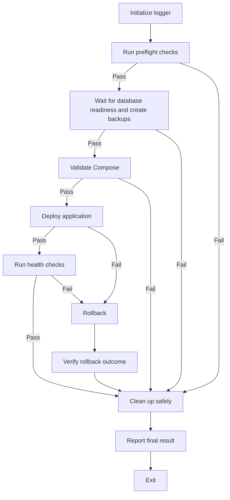

# Docker Deployment Automation

Build or improve a simple Python deployment runner for a Docker Compose application.

Keep the implementation small and explicit. Add only code required for the project and this deployment flow. Do not add frameworks, dependencies, abstraction layers, or configuration systems without a clear need.

## Usage

Run the deployment from PowerShell or a Unix shell with:

```bash
python deploy.py
```

Use Python and standard library features for cross-platform behavior. Use `pathlib` for paths and `subprocess` with argument lists and `shell=False` for commands. Do not use Bash-only syntax, shell scripts, Unix-only paths, or platform-specific command chaining.

## Before changing

Before writing code:

- Inspect the project structure, technology stack, Compose files, scripts, environment variables, secrets, databases, services, and health endpoints.
- Reuse existing scripts and configuration.
- Preserve existing behavior and touch only required files.
- Create the required structure only when the project does not already provide it.
- Do not invent database, Nginx, API, or health-check commands.
- Treat environment values and external configuration as untrusted input.
- Fail safely when project behavior is unclear instead of guessing.

## Create the required structure

```text
deploy.py
scripts/
    logger.py
    preflight.py
    backup.py
    deployment.py
    health.py
    rollback.py
    cleanup.py
```

Give each module one responsibility. Keep all orchestration in `deploy.py`.

## Deployment flow

Run these stages in order:



Send an unexpected exception to rollback when deployment may have started. Otherwise, send it to cleanup. Send both paths to final reporting.

### 1. Initialize logging

- Initialize terminal and file logging.
- Preserve logs between executions.
- Record timestamps, stages, command results, errors, and final results.
- Never log secret values, passwords, tokens, private keys, or complete environment contents.
- Redact sensitive command output before displaying or storing it.

#### Format terminal output

Write complete, natural-language sentences. Explain each action or result. Avoid unexplained shorthand.

Use this format:

```text
[INFO] Starting the Docker deployment.

[INFO] Running preflight checks.
[ OK ] Docker is running.
[ OK ] Docker Compose is available.
[ OK ] The environment file was found.
[PASS] Preflight checks completed successfully.

[INFO] Creating backups.
[ OK ] The database backup was saved.
[ OK ] The configuration files were backed up.
[PASS] Backups were created at backups/backup_20261011_092119.

[INFO] Deploying the application.
[INFO] Pulling the database image.
```

Use message levels consistently:

- Use `[INFO]` for stages and progress messages.
- Use `[ OK ]` for an individual successful check or action.
- Use `[PASS]` for a completed stage.
- Use `[WARN]` for a non-fatal warning.
- Use `[FAIL]` for a failed check, action, or stage.
- Write every message as a clear sentence.
- Do not expose secrets or unexplained raw command output.

Apply terminal colors safely:

- Use ANSI colors only for interactive terminal output.
- Use cyan or blue for `[INFO]` and stage headings.
- Use green for `[ OK ]` and `[PASS]`.
- Use yellow for `[WARN]`.
- Use red for `[FAIL]`.
- Keep file logs uncolored and timestamped.
- Disable colors when output is not a TTY or when `NO_COLOR` is set.
- Keep colors and formatting out of exit codes and file log content.

### 2. Run preflight checks

- Check required tools, Docker, Docker Compose, Compose configuration, required environment variable names, permissions, disk space, and project-specific prerequisites.
- Detect the available Docker Compose command without assuming a shell or operating system.
- Stop immediately when a required check fails.
- Do not deploy or roll back after a preflight failure.
- Run safe cleanup, report the result, and return a nonzero exit code.

### 3. Create backups

- Back up the database when the project supports it.
- When a database is used, wait until its initialization has completely finished and its readiness check succeeds before creating the backup.
- Stop deployment if database readiness is not reached.
- Back up required configuration and recovery files.
- Use unique timestamped locations and preserve existing backups.
- Verify every required backup.
- Never overwrite the only valid backup.
- Stop immediately when a required backup fails.
- Do not deploy or roll back after a backup failure.
- Preserve recovery files, run safe cleanup, report the result, and return a nonzero exit code.

### 4. Validate Compose

- Validate the Docker Compose configuration before changing running services.
- Keep Compose validation in `scripts/deployment.py`.
- Stop when validation fails. Do not roll back because no deployment change has occurred.

### 5. Deploy the application

- Deploy with the project’s Compose configuration.
- Pass commands as argument lists and capture output and exit codes.
- Record failures without exposing secrets.
- Avoid destructive Docker commands.
- Treat deployment failures as rollback-triggering failures.

### 6. Run health checks

- Check applicable container status, Nginx availability, backend API availability, and representative application behavior.
- Skip checks for services the project does not use.
- Read timeouts, retry limits, polling intervals, endpoints, and expected responses from the project’s existing configuration.
- Trigger rollback when a required health check fails.

### 7. Roll back when required

- Restore the previous working application version after a deployment or health-check failure.
- Use preserved recovery artifacts.
- Restore database backups only when explicitly required and safely supported.
- Verify application health after rollback.
- Preserve backups, rollback files, logs, and diagnostics.
- Do not claim rollback success without recovery and verification.
- Report rollback failures and return a nonzero exit code.

### 8. Clean up safely

- Remove only eligible temporary files and resources.
- Never remove Docker volumes, persistent application or database data, backups, recovery files, deployment logs, or rollback resources.
- Never use destructive Docker cleanup commands that can remove persistent data.
- Attempt cleanup after successful and failed executions.

### 9. Report the result

- Generate a summary for every outcome.
- Include deployment status, completed and failed stages, health-check results, rollback outcome, cleanup outcome, relevant errors, and backup and log locations.
- Run final reporting after every failure, including unexpected exceptions.

### 10. Exit

- Return exit code `0` only when deployment and required health checks succeed.
- Return a nonzero exit code for every required failure, failed rollback, or unexpected exception.

## Failure handling

- Stop normal deployment after a required stage fails.
- Skip rollback after preflight, backup, or Compose validation failures because no service change has occurred.
- Attempt rollback after deployment or health-check failures.
- Attempt rollback after an unexpected exception if deployment may have started.
- Handle command failures and unexpected exceptions explicitly.
- Use simple, consistent return values or exceptions between modules.
- Send rollback success and rollback failure through cleanup.
- Preserve the original failure when rollback or cleanup also fails.
- Always run cleanup and final reporting from a protected finalization path.

## Assign module responsibilities

- Configure terminal/file logging and secret redaction in `scripts/logger.py`.
- Validate tools, configuration, environment, permissions, and disk space in `scripts/preflight.py`.
- Create, verify, and describe recovery backups in `scripts/backup.py`.
- Validate Compose and execute deployment commands in `scripts/deployment.py`.
- Perform configurable readiness and functionality checks in `scripts/health.py`.
- Restore the previous version and verify recovery in `scripts/rollback.py`.
- Remove only safe temporary resources in `scripts/cleanup.py`.
- Orchestrate stages, failures, rollback, cleanup, reporting, and exit codes in `deploy.py`.

## Code quality

- Use standard Python features and existing project dependencies.
- Avoid unnecessary dependencies, classes, wrappers, abstractions, configuration files, and duplicated logic.
- Keep functions focused and names descriptive.
- Follow existing project conventions.
- Keep environment-specific configuration outside source code.
- Add short comments only where code is hard to understand or its behavior is not obvious, especially for safety-related decisions.
- Do not comment obvious operations or repeat what the code already says.
- Do not suppress errors, weaken tests, or remove assertions to obtain a passing result.
- Prefer the smallest complete implementation over a flexible or general-purpose design.

## Expected deliverable

Provide a concise summary. Include:

1. List created or modified files.
2. Describe implementation and failure-handling behavior.
3. List verification commands that you ran.
4. Report verification results.
5. Document project-specific assumptions, unsupported checks, or required configuration.

## Verification checklist

Use mocks or safe test doubles for commands that could affect production services. Verify the following:

- [ ] Verify the execution order.
- [ ] Confirm that database initialization completes before database backups are created.
- [ ] Confirm that preflight and backup failures stop deployment and do not trigger rollback.
- [ ] Confirm that Compose validation occurs before deployment.
- [ ] Confirm that Compose validation failures do not trigger rollback.
- [ ] Confirm that deployment and health-check failures trigger rollback.
- [ ] Confirm that rollback failures are reported and return a nonzero exit code.
- [ ] Confirm that final reporting runs for every outcome.
- [ ] Confirm that cleanup protects backups, logs, volumes, persistent data, and recovery files.
- [ ] Confirm that secrets are absent from terminal and log output.
- [ ] Confirm that existing tests continue to pass.

Run relevant project checks and tests. Report unavailable checks instead of claiming that they passed.
